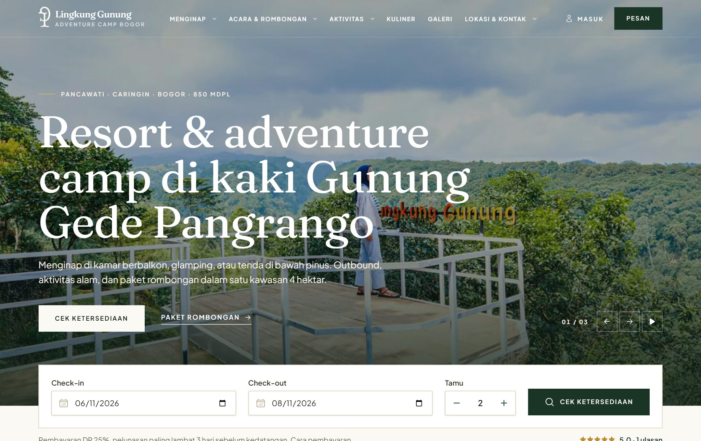
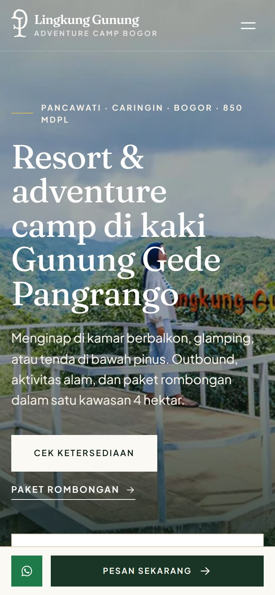
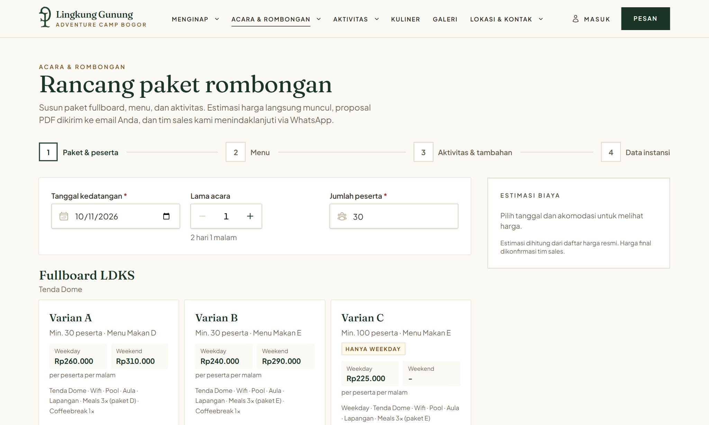
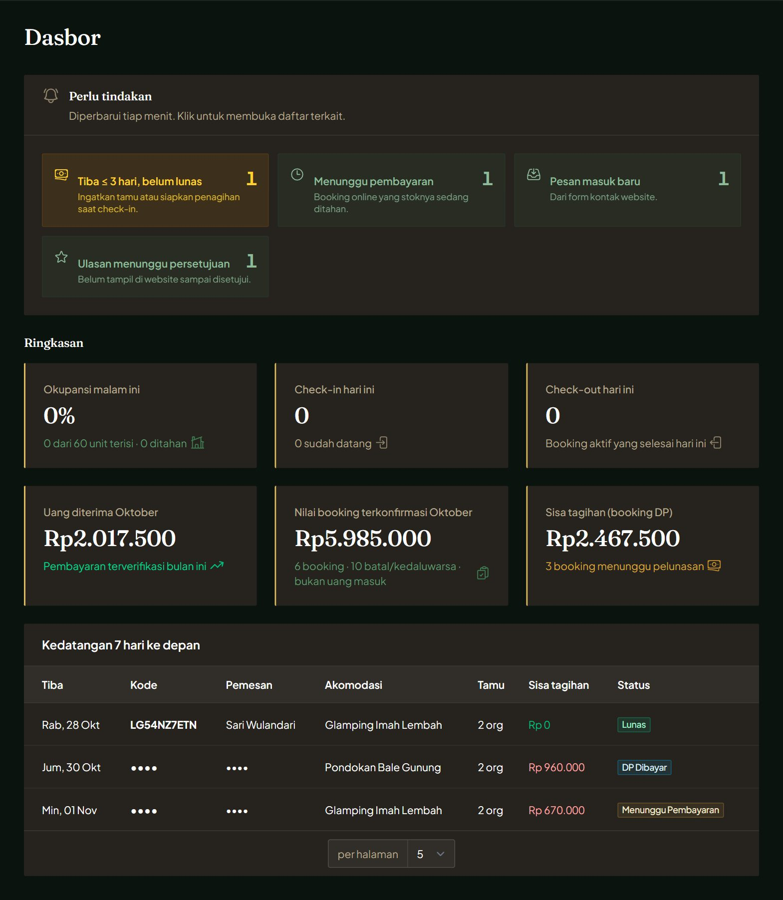

# Lingkung Gunung Adventure Camp Resort Bogor

Official website and direct booking system for **Lingkung Gunung Adventure Camp Resort**, a nature resort at the foot of Mount Gede Pangrango, Bogor, Indonesia.

The application combines a public website, an online booking engine with payment gateway integration, a group package builder for corporate and school events, customer accounts, and a full back-office admin panel in a single Laravel monolith.


## My role

Solo project, built end to end:

- Requirements analysis and technical planning based on the resort's official brochure and price list
- Database design, including per-night inventory and booking state machine
- Backend business logic, payment gateway integration and webhook handling
- Public website, booking flow and customer accounts (UI/UX, mobile-first)
- Admin panel, role-based access and reporting
- Automated tests, security hardening, deployment and backup setup
- User manual and presentation for the resort owner

## Product Decisions

The goal in the technical plan was to move bookings away from online travel agents, which take a 15–25% commission, to a channel the resort owns. Most decisions below follow from that goal and from building it alone, at zero budget, in a fixed timeline.

### 60-minute inventory hold

When a guest clicks *Pay*, the selected units are reserved for 60 minutes and released automatically if payment does not arrive. The hold has to be long enough for a guest to finish a Midtrans payment (a bank transfer or virtual account payment often happens outside the browser), but short enough that abandoned checkouts do not block the last unit on a busy weekend.

- A scheduler releases expired holds every minute, so stock comes back without staff action.
- One customer account can have at most 3 unpaid holds at a time, so a single user cannot hoard availability.
- If a payment arrives after the hold expired, the system re-reserves the units only if they are still free. Otherwise the booking is flagged for a manual refund instead of being overbooked.
- The duration is a setting in the admin panel, not a constant in code.

[ISI: why 60 minutes and not 30 or 120, e.g. input from the resort or observed payment times]

### 25% deposit, balance due 3 days before arrival

Guests choose between paying a 25% deposit or paying in full. A deposit lowers the upfront cost for guests booking weeks ahead, while the resort still gets a paid commitment for the dates.

- Bookings made fewer than 3 days before arrival can only be paid in full, so no guest arrives with an unpaid balance.
- Balance reminders go out by email 7 and 4 days before arrival, each with a fresh payment link.
- The percentage and the deadline are admin settings, because they are the resort's policy, not a technical choice.

[ISI: was 25% the resort's existing policy, or a value I proposed?] The cancellation and refund policy for deposits is still an open question for the resort (see `docs/DATA-TODO.md`).

### Separate flows for direct bookings (B2C) and the Package Builder (B2B)

Families and travelers buy a fixed product (a unit for a number of nights) and can pay right away. Companies, schools and communities buy a configurable package: minimum participants, a menu for every meal, activities, add-ons and weekday-only variants. Their price is not final until sales confirms the details, and they need a document they can pass around internally.

- The B2B flow therefore ends in a quotation with a PDF proposal and a WhatsApp hand-off to sales, not in a payment screen.
- Only after the deal is agreed does staff convert the quotation into a booking. The conversion uses the same `BookingService` and inventory locking as B2C, so there is one set of stock rules for every channel.
- Sales can extend the hold to up to 7 days during conversion, to fit the slower payment process of institutions.

### Verified-only reviews

On a booking site the resort runs itself, reviews only persuade visitors if they can trust that real guests wrote them.

- Only a signed-in customer whose own booking was checked in, and whose check-out date has passed, can write a review. Paid bookings where the guest never arrived cannot be reviewed.
- One review per booking per item, enforced by a unique database index.
- Every review is moderated before it is published.
- When there are no published reviews, the site shows no rating at all instead of a default score.
- `aggregateRating` structured data is intentionally left out, because Google does not show self-collected reviews for local businesses and may treat them as a violation.

### Unconfirmed products are not bookable online

Where the brochure was unclear (for example Camp Site capacity and Campervan pricing), online booking is switched off for that product until the resort confirms the numbers, and guests are directed to WhatsApp instead. Selling a unit at the wrong price would cost more than missing an online booking. The open questions are tracked in `docs/DATA-TODO.md`.

## What I Deprioritized

The MVP scope was locked to keep a one-person, 13-week plan on track. These items were moved to a later phase:

- Automatic WhatsApp notifications (email is used for e-tickets and reminders)
- A mobile app (the website is mobile-first instead)
- A loyalty program
- Channel manager integration with OTAs. Until then, staff must manually block dates that were sold on OTAs, to avoid double bookings across channels.

[ISI: why these items were deprioritized, and anything else you cut during development]

## Outcome

- Status: [ISI: e.g. live / in UAT / handed over to the resort, plus the date]
- Live URL: [ISI: website URL, if public]
- Bookings through the website: [ISI: number of bookings per month]
- Share of direct bookings compared to OTAs: [ISI: percentage, if the resort tracks it]
- Feedback from the owner and staff: [ISI: a short quote or summary]

## Screenshots

| Home page | Mobile |
|---|---|
|  |  |

| Group package builder | Admin dashboard |
|---|---|
|  |  |

## Features

### Public website
- Accommodation catalogue (rooms, glamping, tents, camping areas) with photo galleries and comparison table
- Activities, group packages, dining menus, gallery, articles, location and contact pages
- Mobile-first design with sticky booking and WhatsApp bar
- SEO: structured data (LodgingBusiness, FAQPage, Article) and XML sitemap
- WebP images with responsive `srcset` and lazy loading

### Direct booking (B2C)
- Real-time availability per unit type and per night
- Weekday, weekend and peak-season pricing with promo codes
- 60-minute inventory hold while the guest completes payment
- Pay a 25% deposit or in full via **Midtrans Snap**, or by manual bank transfer
- E-ticket with QR code (PDF) and email confirmation
- Automatic balance reminders before arrival

### Group package builder (B2B)
- Guests design full-board packages (outbound, leadership training, gatherings) with menus, activities and add-ons
- Live price estimate and validation of package rules (minimum participants, weekday-only variants)
- Automatically generated PDF proposal sent by email
- Sales team follows up, edits and converts quotations into bookings

### Customer accounts
- Registration, email verification, password reset
- Booking history, payment status and e-tickets
- Wishlist of saved accommodations
- Claim past bookings with booking code and phone number

### Guest reviews
- Verified reviews only, available after check-out
- Ratings for the resort, accommodations, activities and packages, with photo uploads
- Moderation workflow in the admin panel

### Admin panel
- Bookings, payments, check-in, walk-in and phone reservations
- Occupancy calendar with date blocking
- Management of unit types, rates, promos, packages, activities and website content
- Contact inquiries, quotations and review moderation
- Revenue, booking and occupancy reports with Excel export
- Role-based access (owner, admin, sales, front office) and mandatory two-factor authentication
- Activity log of staff actions

## Tech stack

| Layer | Technology |
|---|---|
| Backend | PHP 8.4, Laravel 13 |
| Admin panel | Filament 5, Filament Shield |
| Frontend | Blade, Livewire 4, Alpine.js, Tailwind CSS 4, Vite |
| Database | MySQL 8.4 |
| Payments | Midtrans Snap |
| PDF | barryvdh/laravel-dompdf |
| Media | spatie/laravel-medialibrary (WebP conversion) |
| Backups | spatie/laravel-backup (AES-256 encrypted) |
| Cache, session, queue | Database driver (no Redis required) |

## Architecture highlights

- **Service layer.** All business logic lives in `app/Services` (booking, pricing, payment, quotation, reviews, reports). Controllers, Livewire components and Filament resources only call these services.
- **Inventory locking.** Availability is stored per unit type per date in `daily_inventory`. Bookings lock the affected rows with `SELECT ... FOR UPDATE` inside a transaction, so two guests can never book the last unit at the same time.
- **Server-side pricing.** Prices are always recalculated on the server; client input is never trusted.
- **Secure payments.** Midtrans webhooks verify the signature, order ID and amount, re-check the status through the Midtrans API, and are processed idempotently. A scheduled reconciliation job catches payments whose webhook never arrived.
- **Non-guessable URLs.** Booking, e-ticket and proposal pages use random codes instead of sequential IDs.
- **Configurable business rules.** Rates, packages, deposit percentage, hold duration and contact details are managed from the admin panel, not hard-coded.

## Getting started

### Requirements

- PHP 8.4 with extensions: `gd`, `intl`, `zip`, `sodium`, `pdo_mysql`
- Composer 2
- Node.js 22.12 or newer
- MySQL 8.4

### Installation

```bash
# 1. Install dependencies
composer install
npm install

# 2. Configure the environment
cp .env.example .env
php artisan key:generate
# Edit .env: database credentials, Midtrans keys, mail settings, ADMIN_PATH

# 3. Set up the database with initial data
php artisan migrate --seed
php artisan storage:link

# 4. Create the first admin account and grant the owner role
php artisan make:filament-user
php artisan shield:super-admin --user=1 --panel=admin

# 5. Start the development server (web server, queue worker, logs and Vite)
composer run dev
```

The site is available at `http://localhost:8000`. The admin panel lives at `/{ADMIN_PATH}` (default `/kelola`).

### Key environment variables

| Variable | Description |
|---|---|
| `ADMIN_PATH` | URL path of the admin panel |
| `ADMIN_REQUIRE_MFA` | Require two-factor authentication for staff |
| `MIDTRANS_SERVER_KEY`, `MIDTRANS_CLIENT_KEY` | Midtrans credentials |
| `MIDTRANS_IS_PRODUCTION` | `false` for sandbox, `true` for live payments |
| `CUSTOMER_EMAIL_VERIFICATION` | Require email verification for customer accounts (must be `true` in production) |
| `BACKUP_ARCHIVE_PASSWORD` | Encryption password for backups |
| `QUEUE_VIA_SCHEDULER` | Process the email queue from cron (for shared hosting) |

See `.env.example` for the full list and `.env.production.example` for production defaults.

### Scheduled tasks

In production, add a single cron entry:

```cron
* * * * * php /path/to/project/artisan schedule:run >> /dev/null 2>&1
```

This runs expiry of unpaid holds (every minute), payment reconciliation (every 5 minutes), balance reminders, daily inventory generation and encrypted backups. During development, use `php artisan schedule:work`.

## Testing

The test suite runs against a dedicated MySQL database (not SQLite) so that row locking behaves as in production.

```bash
# Create the test database once
mysql -u root -p -e "CREATE DATABASE lingkung_gunung_test"

php artisan test
```

Coverage includes weekday/weekend pricing, concurrent bookings competing for the last unit (run in parallel processes), Midtrans webhook signature validation and idempotency, customer accounts, reviews and security regressions.

## Useful commands

| Command | Description |
|---|---|
| `php artisan inventory:generate` | Prepare daily inventory for the next 365 days |
| `php artisan bookings:expire-holds` | Release unpaid holds older than 60 minutes |
| `php artisan payments:reconcile` | Re-check pending transactions with Midtrans |
| `php artisan bookings:send-reminders` | Send balance payment reminders |
| `php artisan backup:run` | Create an encrypted backup |
| `php artisan resort:cek-produksi` | Check production readiness of the environment |
| `vendor/bin/pint` | Format PHP code |

## Project structure

```
app/
├── Console/Commands/   Scheduled and maintenance commands
├── Enums/              Booking, payment and review statuses
├── Filament/           Admin panel resources, pages and widgets
├── Http/               Controllers, middleware and form requests
├── Livewire/           Booking wizard, package builder, review form
├── Models/
├── Services/           Business logic
└── Support/            Helpers (e-ticket, images, contact info)
resources/views/
├── public/             Public website pages
├── akun/               Customer account pages
├── components/         Reusable Blade components
└── pdf/                E-ticket and proposal templates
docs/                   Deployment, security, testing and user guides
tests/Feature/          Feature and regression tests
```

## Documentation

| Document | Contents |
|---|---|
| [`docs/DEPLOY.md`](docs/DEPLOY.md) | Server deployment guide |
| [`docs/MIDTRANS-SANDBOX.md`](docs/MIDTRANS-SANDBOX.md) | Midtrans sandbox setup |
| [`docs/SECURITY-CHECKLIST.md`](docs/SECURITY-CHECKLIST.md) | Security checklist before go-live |
| [`docs/UAT-CHECKLIST.md`](docs/UAT-CHECKLIST.md) | User acceptance testing checklist |
| [`docs/AKSES-HALAMAN.md`](docs/AKSES-HALAMAN.md) | Route and access control inventory |
| [`docs/lingkung-gunung-website-user-manual-id.pdf`](docs/lingkung-gunung-website-user-manual-id.pdf) | User manual for resort staff (Indonesian) |

Most project documentation is written in Indonesian. The public website interface is in Indonesian.

## Credits

Photographs, logo and brand assets belong to Lingkung Gunung Adventure Camp Resort Bogor and are used for this project only.

## License

Copyright © 2026 Kenneth Andreas. All rights reserved.

This repository is published as a portfolio showcase. The source code may not be copied, modified or distributed without written permission.
